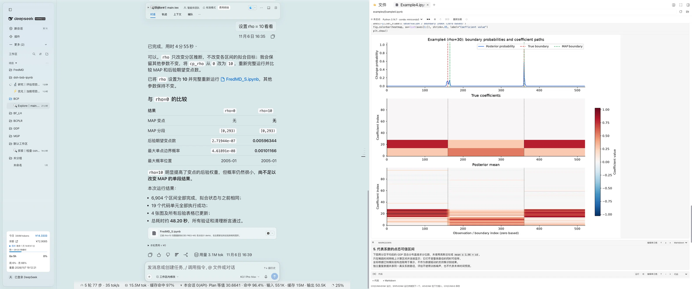

<p align="center">
  
</p>

<h1 align="center">dsh-bsb-ipynb</h1>

<p align="center">
  Read, edit, run and save Jupyter notebooks inside the DSH Better Sidebar.
</p>

<p align="center">
  <a href="https://github.com/kexiongwen/dsh-bsb-ipynb"></a>
  <a href="https://github.com/kexiongwen/dsh-bsb-ipynb/actions/workflows/test.yml"></a>
  <a href="LICENSE"></a>
  <a href="https://nodejs.org"></a>
  <a href="https://github.com/deepseek-ai/deepseek-harness"></a>
  <a href="https://github.com/dong-victor/dsh-better-sidebar"></a>
</p>

<p align="center">
  <a href="README_ZH.md">中文</a> · English
</p>

`dsh-bsb-ipynb` is a [DSH Better Sidebar](https://github.com/dong-victor/dsh-better-sidebar) plugin that turns the sidebar's file tree into a Jupyter notebook workspace. Click any `.ipynb` to read, edit, run and save it as you would in Jupyter. Kernels run in the host process through `jupyter_client` + `ipykernel`, so nothing Python-related runs in the browser and there is no build step.

<p align="center">
  
</p>

## ✨ Features

- **Notebook rendering** — Markdown, code and raw cells with execution counts; streaming stdout/stderr, `text/html` (sanitized against an allow-list), PNG/JPEG/SVG (`image/jpg` is accepted as an alias for `image/jpeg`), Markdown, JSON and ANSI-colored tracebacks.
- **Cell editing** — click a cell to edit it; insert or delete cells, move them up/down, switch cell types, preview Markdown, and clear one cell's or all outputs.
- **Execution** — one persistent kernel per notebook, keyed by file path, keeps variables alive across cells; Run all, interrupt, restart and shut down.
- **Saving** — writes nbformat 4.5 with sha256-based optimistic concurrency (conflicts return 409 and never overwrite); atomic writes through a same-directory temp file and rename; autosave 1.5 s after edits.
- **Interpreter discovery** — checks `DSH_IPYNB_PYTHON`, conda environments, `python3`/`python` on `PATH`, then DSH's bundled Python, and selects only environments that provide `jupyter_client` + `ipykernel`. `DSH_IPYNB_PYTHON` must be an absolute path; a relative or unusable value is still listed by `/ipynb/interpreters` with a reason but is never used. The launch config is built in-process, so a same-named system kernelspec cannot redirect the selected interpreter.
- **DSH integration** — core base colors use DSH theme tokens (syntax and state colors remain hard-coded), and dark mode follows the DSH theme; UI strings are registered under the `dsh-bsb-ipynb` locale namespace and follow DSH's Chinese/English language preference.
- **Contained access** — paths are confined to the session workspace (realpath + relative checks); HTTP routes reuse DSH's admission fence; HTML output is sanitized with a DOMParser allow-list, and `<script>` never runs.

## 🚀 Quick Start

| Requirement | Version / notes |
| --- | --- |
| DSH | Web GUI **0.2.2-rc.1** or newer |
| dsh-better-sidebar | **0.30.x** (verified with 0.30.1; 0.28.x targets DSH 0.2.1 and is not recommended) |
| Python | `jupyter_client` + `ipykernel`; verify with `python3 -c "import jupyter_client, ipykernel"` (macOS/Linux) or `python -c "import jupyter_client, ipykernel"` (Windows) |

```bash
# if the dependencies are missing
python3 -m pip install jupyter_client ipykernel   # macOS / Linux
python -m pip install jupyter_client ipykernel    # Windows (or: py -3 -m pip ...)
```

1. Open DSH's plugin manager and install this repository folder as a local bundle.
2. Refresh the page (`Cmd+R` on macOS; `Ctrl+R` or `F5` on Windows).
3. Open any `.ipynb` from the right-hand file tree; [examples/demo.ipynb](examples/demo.ipynb) is a good first run.

> **Windows**: interpreter discovery looks for `python.exe`/`python3.exe` on `PATH` (Microsoft Store app-execution aliases under `WindowsApps` are skipped), conda environments (`<env>\python.exe`) and DSH's bundled Python. Set `DSH_IPYNB_PYTHON` to an **absolute** `python.exe` path when the interpreter lives elsewhere; read-only or locked notebooks reject saves with `write-blocked` (409) until the file is writable again, and reading a file locked by another program returns `read-blocked` (409).

## 🖱️ Usage

| Action | Shortcut |
| --- | --- |
| Run the current cell | `Cmd/Ctrl + Enter` |
| Run and advance to the next cell | `Shift + Enter` |
| Insert a code cell below | `Alt + Enter` |
| Save | `Cmd/Ctrl + S` |
| Outdent the current line | `Shift + Tab` |
| Leave edit mode | `Esc` |

Shortcuts work while a cell is being edited; Tab inserts four spaces and Shift+Tab removes one indent unit. Every action is also available from the toolbar (interpreter, Run all, interrupt, restart, save, reload, shut down kernel).

- Autosave pauses while a cell or Run all is running, so transiently cleared or partial outputs never reach disk.
- Switching interpreters restarts the kernel; an active run asks for confirmation first.
- A file changed on disk produces a 409 conflict that can only be resolved by reloading — external edits are never overwritten.
- The notebook is measured in its on-disk form before upload; above 32 MiB the UI asks you to clear outputs or trim content instead of failing with a 413 after the fact.

## 🧱 Architecture

```text
dsh-bsb-ipynb/
├── index.js          # host plugin entry: registers /ipynb routes and owns kernels
├── client.js         # browser bundle (hand-written, no build step)
├── lib/
│   ├── routes.js     # /ipynb/* HTTP API
│   ├── kernel.js     # one bridge process per notebook, event queue, idle sweep
│   ├── notebook.js   # nbformat 4 parse/normalize/serialize, sha256 versions, atomic writes
│   ├── gate.js       # session workspace resolution and path escape protection
│   ├── env.js        # Python interpreter discovery and probing
│   └── json.js       # JSON envelope, request body reader, ApiError
├── python/bridge.py  # JSONL kernel bridge over jupyter_client + ipykernel
├── locale/{en,zh}.json
└── test/             # node:test unit/integration tests (including real kernels)
```

Request path: browser `client.js` → better-sidebar `webServer` → `/ipynb/*` routes → `KernelManager` → `python/bridge.py` (JSONL) ↔ `ipykernel`.

## 🛡️ Reliability

- **Serialized saves** — concurrent saves of the same notebook run in order; only the first succeeds and the rest return `write-conflict` (409).
- **Blocked saves** — a read-only notebook, or one held open by another program (common on Windows), returns `write-blocked` (409) with a fixable message instead of an internal error; autosave backs off up to 30 s and the response never embeds local paths or temp-file names.
- **Safe writes** — write a temp file in the same directory, check the version again, then rename it into place; this narrows the external-write race window (extreme interleavings remain a known race). If a crash leaves a `.dsh-bsb-ipynb-*.tmp` behind, the next save sweeps stale ones older than an hour.
- **No stalled streams** — restart/shutdown, kernel death or `os._exit()` always ends the NDJSON stream with a terminal failure event.
- **Complete output** — after the kernel replies, the bridge waits for the matching IOPub idle; after 10 s it reports a failure and warns that output may be incomplete.
- **Resource limits** — 32 MiB of client-side output per cell, a 64 MiB server-side NDJSON queue and a 64 MiB cap per kernel output line; exceeding a limit cancels the run and interrupts the kernel.
- **Kernel cleanup** — idle kernels are swept after 30 minutes (`DSH_IPYNB_KERNEL_IDLE_MS`); ready timeout is 30 s; shutdown waits 2 s, sends SIGTERM, then SIGKILL 2 s later.
- **Process cleanup** — the kernel connection file is removed on every exit path (the host owns its path, so a hard-killed bridge leaves nothing behind); on Windows a kill-on-close job object reaps the kernel and any subprocess a cell spawned.
- **Restart resilience** — a failed kernel restart reports `kernel_died` and tears the bridge down instead of busy-looping; restarts run off the control loop, so status/interrupt/shutdown stay responsive during a slow restart.

## 🌐 HTTP API

All routes are mounted under `/ipynb` and return `{ok:true,value}` or `{ok:false,error:{code,message,details?}}`. POST bodies must be `application/json`; `/execute` responds with `application/x-ndjson`.

| Method | Path | Description |
| --- | --- | --- |
| GET | `/ipynb/health` | Version, kernel count, interpreter stats (non-blocking; `interpreters.checked=false` until warm) |
| GET | `/ipynb/interpreters` | Interpreter list and default |
| GET | `/ipynb/status?sessionId=&path=` | Kernel status for a notebook |
| POST | `/ipynb/read` | Read and parse a notebook |
| POST | `/ipynb/save` | `{notebook, baseVersion}`; a stale version returns 409 |
| POST | `/ipynb/execute` | `{cellId, code, python?}`; NDJSON execution events |
| POST | `/ipynb/interrupt` | Interrupt the current execution |
| POST | `/ipynb/restart` | Restart the kernel, optionally switching `python` |
| POST | `/ipynb/shutdown` | Shut the kernel down |

All routes except `/health` and `/interpreters` require a non-empty `sessionId` and `path` (query parameters for `/status`, JSON body for the rest). `/execute` reports pre-header errors as the JSON envelope; after headers, failures arrive as `{type:'fatal',code,message}` NDJSON events.

Error codes: `bad-request`, `forbidden`, `workspace-unknown`, `path-outside-root`, `not-found`, `read-blocked`, `not-notebook`, `too-large`, `write-conflict`, `write-blocked`, `write-failed`, `kernel-busy`, `kernel-unavailable`, `interpreter-unknown`, `method-not-allowed`, `internal`.

## ⚠️ Known Limitations

- Python kernels only (nbformat 4.x). Interactive JavaScript outputs (ipywidgets, plotly, bokeh, …) are not rendered; HTML is sanitized into static content.
- No `input()`: kernels start with `allow_stdin=False`, so calls fail immediately rather than hanging. `%%` cell magics and `!cmd`, `%pip`, `%cd`, `%pwd` work.
- If the kernel is still unresponsive about 3 s after an interrupt, it is force-restarted and all variables and kernel state are lost.
- Results are written back by the client and persisted on save; the server never appends output in the background.
- No "new notebook" wizard yet: create an empty `.ipynb` in the file tree or open an existing file.
- Workspace containment uses the session cwd; when the active root is a linked git worktree, requests may return 403 (not supported yet).
- **Windows**: an interrupt cannot reach ipykernel, so it force-restarts the kernel after about 3 s and clears all variables (the generic interrupt timeout above); read-only or locked notebooks reject saves with `write-blocked` (409) and locked files fail reads with `read-blocked` (409); images inside `text/html` output are not re-resolved.
- Very large outputs make browser rendering slow; clear outputs or run in smaller chunks.

## 📊 Internal Limits and Environment Variables

| Item | Value |
| --- | --- |
| Notebook file size cap | 32 MiB (files above this are rejected with 413) |
| POST request body cap | 64 MiB (36 MiB on `/ipynb/save`) |
| Client output budget per cell | 32 MiB (UTF-8 bytes of the complete JSON) |
| Pending NDJSON queue / single kernel output line | 64 MiB / 64 MiB |
| Metadata nesting / node limit | 100 levels / 10,000 nodes |
| Autosave / kernel status polling / NDJSON ping | 1.5 s / 10 s / 15 s |
| Ready timeout / shutdown grace / interrupt grace | 30 s / 2 s + 2 s / 3 s |
| Execute stream drain timeout | 10 s (a client that stops reading is disconnected) |
| Kernel idle sweep | 30 minutes by default; `DSH_IPYNB_KERNEL_IDLE_MS` changes it (`0` disables the sweep) |

## 🧪 Development & Testing

There is no build step. DSH caches registered bundles, so after changing `client.js` or host-side code, reload the `dsh-bsb-ipynb` plugin (or restart DSH) to apply it; after client changes also hard-refresh the page (`Ctrl/Cmd+Shift+R`).

```bash
for file in index.js lib/*.js client.js; do node --check "$file"; done
python -m py_compile python/bridge.py
npm test          # 325 tests at the time of writing
```

Real-kernel tests skip automatically when no candidate interpreter provides `jupyter_client`/`ipykernel`; schema tests that need `nbformat` skip as well. Set `DSH_IPYNB_TEST_PYTHON` to choose the interpreter used by tests; in CI, set it explicitly and check for unexpected skips. CI runs the suite on `ubuntu-latest`, `windows-latest` and `macos-latest`. The ~28 case-sensitivity regression tests in `test/control-symlink.test.mjs` run only on case-insensitive file systems (macOS APFS, Windows NTFS) that also allow symlink creation; on Linux or a Windows account without Developer Mode they skip through the capability probe. The access-control cases in `test/routes.test.mjs` that need a non-root user skip automatically when the suite runs as root.

See [CODE_REVIEW.md](CODE_REVIEW.md) for the combined macOS + Windows review and known-issue log.

## 🤝 Contributing

Issues and pull requests are welcome. See [CONTRIBUTING.md](CONTRIBUTING.md) for setup, tests and PR guidelines, and report security issues privately as described in [SECURITY.md](SECURITY.md). Keep the client bundle hand-written and build-free (no bundler or new runtime dependencies).

## 📄 License

MIT © 2026 dsh-bsb-ipynb authors — see [LICENSE](LICENSE).

`python/bridge.py` and parts of the rendering algorithms are adapted from the MIT-licensed [dong-victor/dsh-better-sidebar-jupyter](https://github.com/dong-victor/dsh-better-sidebar-jupyter); the design references [kikulmj/dsh-jupyter](https://github.com/kikulmj/dsh-jupyter) (Apache-2.0). Full attribution and upstream license texts are in [NOTICE](NOTICE).

[](https://github.com/deepseek-ai/deepseek-harness)
