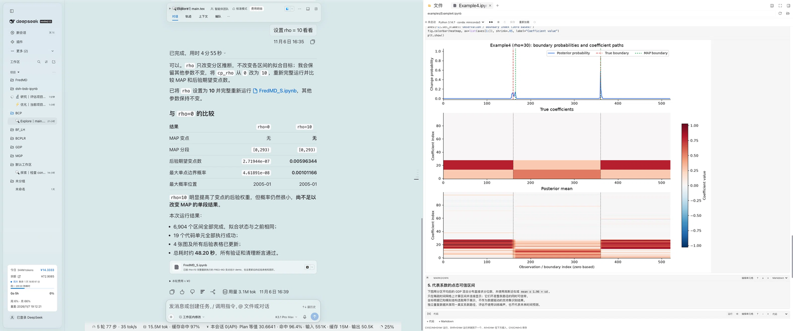

<p align="center">
  
</p>

<h1 align="center">dsh-bsb-ipynb</h1>

<p align="center">
  在 DSH Better Sidebar 中阅读、编辑、运行并保存 Jupyter Notebook。
</p>

<p align="center">
  <a href="https://github.com/kexiongwen/dsh-bsb-ipynb"></a>
  <a href="https://github.com/kexiongwen/dsh-bsb-ipynb/actions/workflows/test.yml"></a>
  <a href="LICENSE"></a>
  <a href="https://nodejs.org"></a>
  <a href="https://github.com/deepseek-ai/deepseek-harness"></a>
  <a href="https://github.com/dong-victor/dsh-better-sidebar"></a>
</p>

<p align="center">
  <a href="README.md">English</a> · 中文
</p>

`dsh-bsb-ipynb` 是一个 [DSH Better Sidebar](https://github.com/dong-victor/dsh-better-sidebar) 插件，把侧边栏文件树变成可用的 Jupyter Notebook 工作区：点开任意 `.ipynb` 即可阅读、编辑、运行并保存，操作体验与 Jupyter 一致。内核由宿主进程通过 `jupyter_client` + `ipykernel` 启动，浏览器端不运行 Python，也无需构建。

<p align="center">
  
</p>

## ✨ 特性

- **渲染**：Markdown、代码与 raw cell（原始单元格），显示执行计数；流式 stdout/stderr、`text/html`（白名单清洗）、PNG/JPEG/SVG（接受 `image/jpg` 作为 `image/jpeg` 的别名）、Markdown、JSON 与 ANSI 彩色 traceback。Markdown 与 `text/html` 输出中的图片按同一规则解析：`attachment:`、相对路径与 Windows 盘符/UNC 路径经宿主文件路由加载，`http(s)` 与 `data:image` 保持原地址直连（远程图片由源站加载）。
- **编辑**：点击单元格进入编辑；插入/删除、上移/下移、切换类型、Markdown 预览、清空单个或全部输出。
- **执行**：每个 notebook 一个按文件路径共享的常驻内核，变量跨单元格保留；支持全部运行、中断、重启与关闭。
- **保存**：写回 nbformat 4.5；以 sha256 版本号实现乐观并发控制（冲突返回 409，绝不静默覆盖）；在同一目录写入临时文件后原子 rename；编辑后 1.5 秒自动保存。
- **解释器发现**：按 `DSH_IPYNB_PYTHON` → conda 环境 → PATH 上的 `python3`/`python` → DSH 内置 Python 的顺序查找，且只选择安装了 `jupyter_client` + `ipykernel` 的环境；`DSH_IPYNB_PYTHON` 必须是**绝对路径**，相对路径或不可用的值仍会出现在 `/ipynb/interpreters` 列表中并附原因，但不会被使用；启动配置在插件进程内构造，同名系统 kernelspec 不会改变所选解释器。
- **与 DSH 集成**：所有颜色跟随 DSH 主题——状态色、banner、链接与 Python 语法高亮消费 `--dsw-alias-*` 与 Shiki 变量，单元格/编辑器/输出字号跟随 DSH 的正文与代码字号设置（暗色即宿主按「主题设置 × 系统配色」解析出的调色板，插件侧不做主题侦测）；界面文案注册在 `dsh-bsb-ipynb` locale 命名空间下，跟随 DSH 的中英文语言偏好。
- **访问边界**：路径限制在会话工作区内（realpath + 相对路径校验）；HTTP 路由复用 DSH 的 admission fence（请求准入校验）；HTML 输出经 DOMParser 白名单清洗，`<script>` 不会执行。

## 🚀 快速开始

| 依赖 | 要求 |
| --- | --- |
| DSH | Web GUI **0.2.2-rc.1** 或更新 |
| dsh-better-sidebar | **0.30.x**（当前验证 0.30.1；0.28.x 面向 DSH 0.2.1，不推荐） |
| Python | 安装 `jupyter_client` + `ipykernel`，可用 `python3 -c "import jupyter_client, ipykernel"`（macOS/Linux）或 `python -c "import jupyter_client, ipykernel"`（Windows）自检 |

```bash
# 如缺少依赖
python3 -m pip install jupyter_client ipykernel   # macOS / Linux
python -m pip install jupyter_client ipykernel    # Windows（或：py -3 -m pip ...）
```

1. 在 DSH 插件管理中将本仓库目录作为本地 bundle 安装；
2. 刷新页面（macOS 为 `Cmd+R`，Windows 为 `Ctrl+R` 或 `F5`）；
3. 在右侧文件树打开任意 `.ipynb`；首次体验可用 [examples/demo.ipynb](examples/demo.ipynb)。

> **Windows**：解释器发现会检查 `PATH` 上的 `python.exe`/`python3.exe`（跳过 `WindowsApps` 下的 Microsoft Store 应用执行别名）、conda 环境（`<env>\python.exe`）与 DSH 内置 Python。若解释器在其他位置，请把 `DSH_IPYNB_PYTHON` 设为该 `python.exe` 的**绝对路径**；只读或被其它程序占用的 notebook 保存会返回 `write-blocked`（409），被其它程序独占锁定的文件读取会返回 `read-blocked`（409），直到文件可用。

## 🖱️ 使用

| 操作 | 快捷键 |
| --- | --- |
| 运行当前单元格 | `Cmd/Ctrl + Enter` |
| 运行并跳到下一个单元格 | `Shift + Enter` |
| 在下方插入代码单元格 | `Alt + Enter` |
| 保存 | `Cmd/Ctrl + S` |
| 反缩进当前行 | `Shift + Tab` |
| 退出编辑 | `Esc` |

运行（`Cmd/Ctrl + Enter`）与保存（`Cmd/Ctrl + S`）快捷键在阅读态也生效（notebook 视图可见时）：目标为获得焦点的单元格，否则为最近编辑或运行的单元格；`Cmd/Ctrl + S` 会被拦截，不再弹出浏览器「保存网页」。编辑时 Tab 插入 4 个空格，Shift+Tab 删除一个缩进单位。所有操作也可通过工具栏完成（解释器选择、全部运行、中断、重启、保存、重新加载、关闭内核）。

- 执行单元格或全部运行期间自动保存暂停，临时清空或未完成的输出不会写入磁盘。
- 切换解释器会重启内核；有执行任务时会先确认。
- 磁盘文件被外部修改时显示 409 冲突，只能重新加载，绝不覆盖外部内容。
- 上传前会按落盘格式测量整本 notebook；超过 32 MiB 时提示清空输出或精简内容，避免上传后才收到 413。

## 🧱 架构

```text
dsh-bsb-ipynb/
├── index.js          # 宿主插件入口：注册 /ipynb 路由并管理内核
├── client.js         # 浏览器 bundle（手写，无构建步骤）
├── lib/
│   ├── routes.js     # /ipynb/* HTTP API
│   ├── kernel.js     # 每个 notebook 一个 bridge 进程、事件队列与空闲回收
│   ├── notebook.js   # nbformat 4 解析/规范化/序列化、sha256 版本、原子写入
│   ├── gate.js       # 会话工作区解析与路径逃逸防护
│   ├── env.js        # Python 解释器发现与探测
│   └── json.js       # JSON envelope、请求体读取、ApiError
├── python/bridge.py  # jupyter_client + ipykernel 的 JSONL 内核桥
├── locale/{en,zh}.json
└── test/             # node:test 单元/集成测试（含真实内核）
```

请求链路：浏览器 `client.js` → better-sidebar `webServer` → `/ipynb/*` 路由 → `KernelManager` → `python/bridge.py`（JSONL）↔ `ipykernel`。

## 🛡️ 可靠性

- **保存串行化** — 进程内，同一 canonical notebook path 的并发保存按序执行，仅第一个成功，其余返回 `write-conflict`（409）；同一 inode 的硬链接别名按不同路径处理，不会彼此串行。
- **保存被阻止** — 目标为只读，或正被其它程序占用（Windows 上常见）时返回 `write-blocked`（409）与可操作提示，而不是内部错误；autosave 最长退避 30 秒，响应中不再包含本地路径或临时文件名。
- **容量阻塞恢复** — 若客户端 preflight 因 notebook 超过 32 MiB 而阻止保存，删除 cell 或缩短源码使其重新低于上限后，autosave 不会自动恢复；需手动点击一次 **Save**。清空输出、重新加载等现有恢复动作不受影响。
- **安全写入** — 先在同一目录写临时文件，rename 前再次校验版本，再原子替换；可缩小外部写入竞态窗口（极端交错仍属已知竞态）。若进程崩溃残留 `.dsh-bsb-ipynb-*.tmp`，后续保存会清理超过一小时的陈旧临时文件。
- **不会挂起** — 重启/关闭、内核崩溃或 `os._exit()` 都会让 NDJSON 流以失败终态结束。
- **输出完整性** — 内核回复后仍等待对应 IOPub idle；超过 10 秒则报失败并提示输出可能不完整。
- **资源上限** — 客户端每单元格 32 MiB，服务端 NDJSON 待发队列 64 MiB、单行内核输出 64 MiB；超限会取消执行并中断内核。
- **内核回收** — 空闲 30 分钟后回收（`DSH_IPYNB_KERNEL_IDLE_MS` 可调）；ready 超时 30 秒；关闭时等待 2 秒、发送 SIGTERM，再等 2 秒发送 SIGKILL。
- **进程清理** — 内核连接文件在所有退出路径上都会被删除（路径由宿主指定，硬杀 bridge 后也不会残留）；Windows 上使用 kill-on-close job object，内核与 cell 内启动的子进程会一起被回收。
- **重启自愈** — 内核重启失败时发送一次 `kernel_died` 并拆掉 bridge，不再忙等；重启在后台执行，慢重启期间 status/interrupt/shutdown 仍可响应。

## 🎨 主题与字体

notebook 自身不带配色方案：`client.js` 在 `.dsh-bsb-ipynb-root` 上声明一层 token 映射（插件变量 → 宿主主题），所有规则只消费这一层。因此覆盖了 DSH 别名 token 的主题或 dsh-web-ui 皮肤会自动重绘 notebook——包括内核状态点、保存失败/报错文案、banner、Markdown 链接与 Python 语法高亮。

| notebook 角色 | 宿主 token |
| --- | --- |
| 正文、次要文案、边框、面板底色 | `--dsw-alias-label-primary` / `--dsw-alias-label-secondary`、`--dsw-alias-border-l1`、`--dsw-alias-bg-layer-1` |
| 单元格/卡片底色、hover 填充 | `--dsw-alias-bg-module-platform`、`--dsw-alias-interactive-bg-hover` |
| 代码块 / 行内代码底色 | `--dsw-alias-markdown-code-block`、`--dsw-alias-markdown-inline-code` |
| 内核状态（off / ready / busy） | `--dsw-alias-label-tertiary`（off）、`--dsw-alias-state-success-primary`、`--dsw-alias-state-warn-primary` |
| 保存失败、stderr、traceback | `--dsw-alias-state-error-primary` |
| 运行中单元格边框、焦点轮廓 | `--dsw-alias-state-business-primary`（焦点轮廓同时尊重 `--dsw-focus-ring-color`） |
| banner | 以 12% 比例对 `--dsw-alias-state-business-primary` / `--dsw-alias-state-error-primary` 做 `color-mix()` |
| Markdown 链接 | `--dsw-alias-link` |
| Python 语法 | `--shiki-token-*`（与 DSH Markdown 代码块共享的 Shiki 调色板） |
| 正文/代码字体 | `--dsh-content-font-size-secondary`（含增量）、`--dsh-code-font-size`、`--ds-font-family-code` |

字号映射：**正文字号**缩放 notebook 正文、Markdown 段落与密集的工具栏小字；**代码字号**缩放单元格源码、编辑器、执行提示符、输出与围栏代码块；**代码字体**替换等宽字体栈；**正文字体**继承宿主 body。默认值与此前逐像素一致（根 13px、代码 12px、工具栏 10–12px）。若宿主 token 缺失（单测、脱离 DSH 的独立渲染），每条声明回退到修复前的硬编码值。

以下内容有意不主题化：ANSI 16 色 stdout（属于内容，同一 notebook 在任何皮肤下颜色一致）、HTML 输出中的内联样式（由 pandas/plotly 等控制）、notebook 图片的白底（保证透明 PNG/SVG 图在暗色主题下可读）。

## 🌐 HTTP API

所有接口挂在 `/ipynb` 下，返回 `{ok:true,value}` 或 `{ok:false,error:{code,message,details?}}`。POST 请求体必须是 `application/json`，`/execute` 返回 `application/x-ndjson`。

| 方法 | 路径 | 说明 |
| --- | --- | --- |
| GET | `/ipynb/health` | 版本、内核数、解释器统计（不阻塞探测；未预热时 `interpreters.checked=false`） |
| GET | `/ipynb/interpreters` | 解释器列表与默认项 |
| GET | `/ipynb/status?sessionId=&path=` | notebook 的内核状态 |
| POST | `/ipynb/read` | 读取并解析 notebook |
| POST | `/ipynb/save` | `{notebook, baseVersion}`；版本过期返回 409 |
| POST | `/ipynb/execute` | `{cellId, code, python?}`；NDJSON 流式事件 |
| POST | `/ipynb/interrupt` | 中断当前执行 |
| POST | `/ipynb/restart` | 重启内核，可同时切换 `python` |
| POST | `/ipynb/shutdown` | 关闭内核 |

除 `/health`、`/interpreters` 外，所有接口都需要非空 `sessionId` 与 `path`（`/status` 使用查询参数，其余使用 JSON body）。`/execute` 在响应头写入前的错误返回 JSON envelope；写入后失败则以 `{type:'fatal',code,message}` NDJSON 事件结束。

错误码：`bad-request`、`forbidden`、`workspace-unknown`、`path-outside-root`、`not-found`、`read-blocked`、`not-notebook`、`too-large`、`write-conflict`、`write-blocked`、`write-failed`、`kernel-busy`、`kernel-unavailable`、`interpreter-unknown`、`method-not-allowed`、`internal`。

## ⚠️ 已知限制

- 仅支持 Python 内核（nbformat 4.x）；不渲染依赖 JavaScript 的交互输出（ipywidgets、plotly、bokeh 等），HTML 会被清洗为静态内容。
- 不支持 `input()`：内核以 `allow_stdin=False` 启动，调用会立即报错而非挂起。`%%` cell magic 与 `!cmd`、`%pip`、`%cd`、`%pwd` 可用。
- 中断后约 3 秒内核仍未响应会被强制重启，所有变量与内核状态都会清空。
- 执行结果由客户端回写并在保存时落盘；服务端不会在后台追加输出。
- 暂无「新建 notebook」向导：可在文件树中新建空 `.ipynb`，或直接打开已有文件。
- 工作区边界基于会话 cwd 校验；会话活动根为 linked git worktree 时可能返回 403（暂不支持）。
- **路径错误信息侧信道**：工作区外已存在且可访问的目标通常返回 403，不存在或不可访问的目标返回 404（可能附 reason）。已通过准入校验的同用户客户端可借此探测宿主路径的存在性/可访问性；该行为不会放开工作区外的读取或写入。
- **Windows**：中断无法送达 ipykernel，约 3 秒后强制重启内核并清空变量（即上文的中断超时行为）；只读或被占用的 notebook 保存返回 `write-blocked`（409），被独占锁定的文件读取返回 `read-blocked`（409）。
- 输出特别大时会拖慢浏览器渲染，建议及时清空输出或分段执行。

## 📊 内部限制与环境变量

| 项 | 值 |
| --- | --- |
| notebook 落盘上限 | 32 MiB（超过返回 413） |
| POST 请求体上限 | 64 MiB（`/ipynb/save` 为 36 MiB） |
| 客户端每单元格输出预算 | 32 MiB（完整 JSON 的 UTF-8 字节） |
| NDJSON 待发队列 / 单行内核输出 | 64 MiB / 64 MiB |
| metadata 嵌套 / 节点上限 | 100 层 / 10,000 个节点 |
| 自动保存 / 内核状态轮询 / NDJSON ping | 1.5 秒 / 10 秒 / 15 秒 |
| ready / shutdown 宽限 / 中断宽限 | 30 秒 / 2 秒 + 2 秒 / 3 秒 |
| 执行流 drain 超时 | 10 秒（客户端停止读取时主动断开） |
| 内核空闲回收 | 默认 30 分钟；可用 `DSH_IPYNB_KERNEL_IDLE_MS` 调整（设为 `0` 表示不回收） |

## 🧪 开发与测试

无需构建步骤。DSH 会缓存已注册的 bundle，修改 `client.js` 或宿主侧代码后，需重载 `dsh-bsb-ipynb` 插件（或重启 DSH）才会生效；修改客户端后还需硬刷新页面（`Ctrl/Cmd+Shift+R`）。

```bash
for file in index.js lib/*.js client.js; do node --check "$file"; done
python -m py_compile python/bridge.py
npm test          # 当前 393 个测试
```

主题测试（`test/client-theme.test.mjs`）用 `test/fixtures/dsh-theme-tokens.json` 中的 stock 调色板解析注入的样式表；DSH 调色板变化时需有意更新该 fixture。真实内核测试会在所有候选解释器都缺少 `jupyter_client`/`ipykernel` 时自动跳过；依赖 `nbformat` 的 schema 测试同样会跳过。可用 `DSH_IPYNB_TEST_PYTHON` 指定测试使用的解释器；CI 中建议显式设置，并检查是否有非预期跳过。CI 在 `ubuntu-latest`、`windows-latest`、`macos-latest` 三平台运行。`test/control-symlink.test.mjs` 中约 28 个大小写回归用例仅在大小写不敏感且允许创建 symlink 的文件系统（macOS APFS、Windows NTFS）上运行；Linux 或未开启 Windows 开发者模式的账号会通过能力探测自动跳过。`test/routes.test.mjs` 中需要非 root 用户的访问控制用例在以 root 运行测试时会自动跳过。

合并的 macOS + Windows 审核与已知问题记录见 [CODE_REVIEW.md](CODE_REVIEW.md)。

## 🤝 贡献

欢迎提交 issue 与 pull request。开发环境、测试与 PR 规范见 [CONTRIBUTING.md](CONTRIBUTING.md)；安全问题请按 [SECURITY.md](SECURITY.md) 私下报告。`client.js` 保持手写、无构建步骤，不引入打包器或新的运行时依赖。

## 📄 许可

MIT © 2026 dsh-bsb-ipynb authors，详见 [LICENSE](LICENSE)。

`python/bridge.py` 与部分渲染算法改写自 MIT 许可的 [dong-victor/dsh-better-sidebar-jupyter](https://github.com/dong-victor/dsh-better-sidebar-jupyter)；设计参考 [kikulmj/dsh-jupyter](https://github.com/kikulmj/dsh-jupyter)（Apache-2.0）。完整归属与上游许可证文本见 [NOTICE](NOTICE)。

[](https://github.com/deepseek-ai/deepseek-harness)
